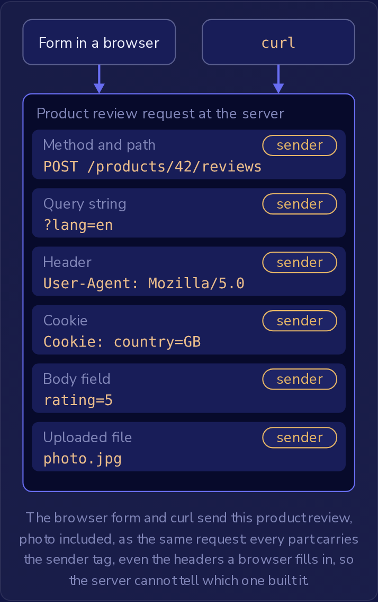

处理请求的服务器永远看不到构建该请求的页面。
它收到的是一个 HTTP 请求（方法和路径、请求头、请求体），而请求的每一部分都由发送者决定。
浏览器提交表单是一种发送者。
另一种是 curl，一个命令行程序，它会发送其参数所描述的任意请求，并且从不加载页面。
以这种方式到达的数据就是**不可信输入**（untrusted input）：在服务器检查之前，它包含的就是发送者想要它包含的任何内容。

一家网上商店的结账页面有这样一个表单：

```html
<form method="post" action="/checkout">
  <input type="hidden" name="price" value="19.99">
  <input type="number" name="quantity" max="10">
  <button type="submit">Buy</button>
</form>
```

购买三件商品的顾客会向 `/checkout` 发送一个 POST 请求，请求体为 `price=19.99&quantity=3`。
下面这条命令以不同的价格发送同样的请求，并且不加载页面：

```bash
curl -d "price=0.50&quantity=3" https://shop.example/checkout
```

`-d` 提供表单请求体，并让 curl 像表单一样发送 POST 请求。
处理程序（handler，即 `/checkout` 的服务器端代码）无论哪种方式都会得到相同的两个字段，请求中没有任何迹象表明页面被跳过了。
`type="hidden"` 只是让输入框不显示在屏幕上。
任何人都可以修改它的值，无论是在浏览器的开发者工具中还是在 curl 中，因此如果处理程序按提交的 `price` 乘以提交的 `quantity` 来收费，这里就会收取 1.50。
处理程序应该在服务器上查询价格，绝不能从请求中读取价格。

请求体只是发送者所写内容的一部分。
路径和查询字符串是发送者所请求的任意 URL，即使链接是由商店自己的页面构建的。
请求头同样由发送者决定：浏览器会用自己的名称填写 `User-Agent`，但 curl 的 `-H` 选项可以添加任意值的任意请求头，因此 `User-Agent` 中出现浏览器名称并不能证明是谁发送了请求。
这也包括 cookie。
服务器响应 `Set-Cookie: country=GB` 之后，后续请求会在 `Cookie` 请求头中带回该值，用户可以在浏览器中编辑它，也可以在 curl 中用 `-H "Cookie: country=US"` 替换它。
服务器只读取到达的内容，除非自己保留了副本，否则不会记得它设置过的值。



浏览器表单和 curl 会把这条商品评论（包括照片）作为同一个请求发送：每一部分都带有发送者标记，甚至包括浏览器自动填写的请求头，因此服务器无法分辨它是由哪一个构建的。

### 入口点与攻击面

处理程序从请求中读取的每个值都是一个**入口点**（entry point），即外部数据到达应用程序的地方。
应用程序的**攻击面**（attack surface）就是它所有入口点的总和：每条路由的路径段、查询字符串参数、请求头、cookie、请求体字段和上传的文件，再加上无需任何请求就到达的输入，例如读取外部文件或消息的后台作业。
代码读取的每个值都算一个入口点，无论它多短，也无论是谁填写的。
一个处理程序从路径中读取订单 ID，并从请求体中读取 `note` 字段，那么它有两个入口点，尽管顾客只输入了备注。

来自代码之外任何一方的数据，都是该方所控制的输入。
合作伙伴或供应商发送的文件包含的是他们放进去的任何内容，因此导入该文件的作业就是一个入口点，不涉及任何 HTTP 请求。
只处理应用程序自身产生的值的代码不会增加入口点：例如对处理程序已计算出的总额进行四舍五入的方法，或者按服务器打上的日期归档订单的作业。
每增加一个入口点，攻击者就多了一个可以探测的地方，其值需要在服务器上检查。

### 检查在哪里运行

在页面中运行的检查是**客户端验证**（client-side validation）：例如 `max`、`min` 和 `required` 这样的 HTML 属性，标记错误值的 JavaScript，以及在表单有效之前一直禁用的提交按钮。
它们只会影响使用该表单的人。
当数量字段为 40 时，浏览器拒绝提交，但 curl 以 `quantity=40` 会直接把 40 发送给处理程序，因为 curl 看不到数字字段，也不运行页面的 JavaScript。
客户端验证仍然对诚实的用户有帮助：输入 12 的顾客会看到问题并在请求发送之前修正，无需往返服务器。
它对服务器端没有任何保护作用。

因此服务器要对它收到的每个请求中的每个值进行检查。
处理程序在创建订单之前就拒绝超过 10 的数量，无论请求来自表单、curl，还是来自移除了 JavaScript 的页面，这项检查的运行方式都相同。
页面已经检查过的字段会再检查一遍：页面的检查是为顾客服务的，服务器的检查则是为了限制。

已保存的值在应用程序读回时仍然是不可信输入。
数据库完全按照服务器写入的样子存储每个值，对表单的规则一无所知。
服务器未经检查就保存的值可能包含发送者选择的任何文本，无论页面的 JavaScript 多么严格，因为保存它的请求可能跳过了页面。
注册时保存的显示名称，数周后在个人资料页面显示时也不会更安全。
给注册处理程序加上检查之后，个人资料页面仍然不能依赖该名称，因为显示它的代码只读取存储的文本，无法分辨是哪段代码保存了它：在加入检查之前保存的名称，或者由跳过检查的导入作业写入的名称，看起来与通过检查的名称完全一样。
所以服务器在收到每个值时就要检查它，而之后读取已保存用户数据的代码也要把它视为不可信输入。
