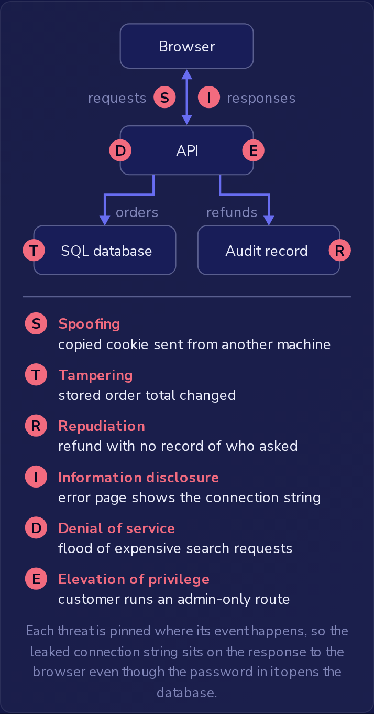

在编写一个功能之前，构建它的开发者可以拿出设计草图，列出可能出错的地方，并决定如何处理每个问题。
这就是威胁建模（threat modeling），而书面成果就是威胁模型（threat model）。
它不需要代码，不需要运行中的系统，也不需要安全团队，只需要了解设计的人。
这里的示例使用一家小型商店：客户在浏览器中使用它，浏览器调用商店 API，API 把订单存储在 SQL 数据库中，并为每次退款写入一条审计记录。

威胁模型按以下顺序回答四个问题：

1. **我们在做什么？** 一张展示各部分以及它们之间数据流动的草图可以回答这个问题。
2. **什么可能出错？** 团队针对草图的每个部分以及各部分之间的每条数据流，逐一检查下面的六个 STRIDE 类别，并写下发现的每个威胁。这份威胁清单就是答案。
3. **我们打算怎么应对？** 团队为清单上的每个威胁选择一个修复方案。
4. **我们做得足够好吗？** 团队检查修复是否有效，并查找清单遗漏的威胁。

STRIDE 帮助团队发现威胁，但走一遍它并不能证明什么：没有人想到的威胁，在所有类别都检查完之后依然存在于设计中。
第四个问题就是为了查找这类威胁，它排在选定修复方案之后，因为它同时也检查修复是否有效。
模型也永远没有完成的时候。
当设计变更时，同一个团队要在变更上线之前，针对变更后的设计再次询问什么可能出错。
新增一条路由算作设计变更，不论它需要多少代码，因为它给攻击面增加了入口点，而它接受的每个字段或文件都是多出来的一个入口点。

### 六个 STRIDE 类别

STRIDE 的名称取自六个威胁类别的首字母。
每个类别都破坏一种安全属性：

- **欺骗**（Spoofing）是冒充其他用户或系统，它破坏**认证**（authentication）。攻击者复制了客户的会话 cookie 并从另一台机器发送；API 把该 cookie 当作调用者身份的证明，并把攻击者当作该客户。使用泄露的密码登录他人账号也是欺骗。
- **篡改**（Tampering）是未经许可更改数据，它破坏**完整性**（integrity）。已存储在数据库中的订单总额被更改。
- **抵赖**（Repudiation）是用户因为没有任何记录表明是谁做的而能够否认某项操作，它破坏**可问责性**（accountability），也称为不可否认性（non-repudiation）。客户说他们从未要求退款，而审计记录没有存储是谁提出的请求，所以没有人能够核实。没有数据丢失或被更改，只是证据从未被保存。防御措施是记录谁在何时做了什么，例如审计记录中存储每次退款背后的账号。
- **信息泄露**（Information disclosure）是数据到达了不该看到它的人手中，它破坏**机密性**（confidentiality）。一个错误页面打印出了数据库连接字符串，其中包括密码。
- **拒绝服务**（Denial of service）是使应用程序停止响应其他用户，它破坏**可用性**（availability）。大量开销高昂的搜索请求让 API 忙得无法响应其他任何人。
- **权限提升**（Elevation of privilege）是账号做了不被允许做的事，它破坏**授权**（authorization）。一个已登录的客户调用了仅限管理员的路由，而该路由运行了。

每个威胁都被固定在其事件发生的位置，因此泄露的连接字符串位于发往浏览器的响应上，尽管其中的密码可以打开数据库。

按所描述事件本身的作用对威胁进行分类。
那个错误页面上的密码以后可能让某人以 API 的身份连接到数据库（欺骗）、更改订单总额（篡改），或者运行任何客户都不被允许运行的查询（权限提升），但这些后续步骤中的每一个都是单独的威胁，需要各自分类。
页面本身把机密展示给了不该看到的人，所以它是信息泄露。
同样的检验方法也可以归类那些看起来与这六个类别毫不相像的威胁：弄清楚该事件对系统造成了什么影响，然后选择具有该影响的类别。

### 认证与授权

认证确定是谁在发出请求；授权决定该身份可以做什么。
正确的密码或有效的会话 cookie 只能告诉 API 是谁在调用，并不能说明该调用者可以做什么，因此面向管理员的路由必须在每个请求上都检查已登录的账号是否为管理员，而不是只在登录时检查。

这种差异区分了上面的两个威胁。
拿着复制来的 cookie 的攻击者获得了客户的权限，不多也不少，所以授权完成了它的工作，而认证失败了：这是欺骗。
访问仅限管理员路由的客户就是他们声称的那个人，所以认证起了作用，而缺少的是授权检查：这是权限提升。
当仅限管理员的路由更改数据时，类别保持不变。
如果该路由批准退款，退款记录会发生变化，但事件仍然是一个账号做了不被允许做的事，所以它是权限提升而不是篡改。

修复保护的是它所针对的那个属性。
再次要求输入密码或更早地让会话过期会增强认证，把每次调用记录到审计记录中提供可问责性，而每分钟调用次数的限制保护可用性。
它们都不能阻止一个正确登录的客户运行仅限管理员的路由。
只有授权检查可以。
