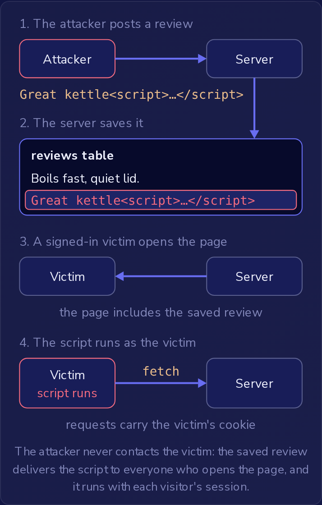

一家商店的商品页面会把每条顾客评价的文本放进它发送的 HTML 中来展示评价。
一位顾客提交了一条评价，文本是 `Great kettle<script>…</script>`，从那以后，每个访客的浏览器都会把这个 `<script>` 元素当作页面的一部分读取并运行。
这就是**跨站脚本攻击**（cross-site scripting，XSS）：输入以标记（markup）的形式进入页面，于是攻击者的代码，即**载荷**（payload），会作为该网站的一部分、带着该用户已登录的会话，在另一个用户的浏览器中运行。
这又是一种注入：输入被粘贴进代码文本后变成了代码，只不过这里的代码文本是页面的 HTML，运行它的程序是受害者的浏览器。
OWASP 将 XSS 列在 A05:2025 注入（Injection）之下。

浏览器无法分辨响应中哪些部分是网站开发者写的，哪些来自某条评价。
响应中的一切都是页面，其中的脚本可以为已登录用户做网站自身的 JavaScript 能做的任何事。

### 存储型、反射型和基于 DOM 的 XSS

在每一次 XSS 攻击中，攻击者和受害者都是不同的人。
这三种类型的区别在于载荷如何到达页面。

**存储型**（Stored）XSS：服务器保存载荷，通常保存在数据库中，并把它包含在发给其他用户的页面里。
上面的评价就是存储型的：每个打开该商品的访客都会运行它，无需点击任何链接。
从应用自己的数据库读回的数据仍然是不可信输入，因为数据库里存的正是用户输入的内容。
受害者是所有打开显示该已保存值的页面的人。
保存在显示名称中、并显示在内部管理页面上的脚本，会在打开该页面的员工浏览器中运行，而员工账号通常能做的事远比顾客账号多。



攻击者从不联系受害者：已保存的评价把脚本送达每一个打开页面的人，并且它带着每位访客的会话运行。

**反射型**（Reflected）XSS：载荷随请求一起传送，服务器把它写入同一个响应中，而不保存。
一个搜索页面会把查询参数 `q` 打印到 `<h2>Results for VALUE</h2>` 中，这样它就会反射 URL 携带的任何内容。
攻击者构造一个 `q` 中含有脚本的链接，并通过电子邮件或聊天消息让受害者打开它。
只有打开该链接的人才会运行脚本，对他们每个人来说，脚本都作为搜索页面的一部分、带着他们的会话运行。

**基于 DOM** 的 XSS：页面自己的 JavaScript 取用攻击者可控的值，并把它写入文档。
一个显示 URL **片段**（fragment，即 `#` 之后的部分）的单页应用可能会运行：

```js
element.innerHTML = decodeURIComponent(location.hash.slice(1));
```

`location.hash` 是带有 `#` 的片段，`slice(1)` 去掉 `#`。
浏览器会对片段中的 `<` 等字符做百分号编码（`<` 变成 `%3C`），而 `decodeURIComponent` 再把它们还原。
浏览器从不把片段发送给服务器，所以载荷永远不会出现在服务器的请求日志中。
攻击依然有效，因为每一步都发生在受害者的浏览器中。

### 汇点

**汇点**（sink）是代码中数据变成标记或代码的地方。
值来自源（source），例如请求、`location.hash` 或数据库，在到达汇点之前不会造成危害。
在上面的 `innerHTML` 那一行中，汇点就是赋值操作：设置元素的 `innerHTML` 会让浏览器把该字符串解析为 HTML，并把生成的元素添加到页面中。
如果代码先用 `+` 拼接各部分来构建字符串，拼接只会产生更长的字符串；字符串是在赋值时才变成标记的。

Razor 有一个服务器端的汇点。
Razor 的 `@` 把值写成文本，所以评价中的 `<` 会在屏幕上显示为字符 `<`。
`Html.Raw` 则把它的参数作为标记写入页面，因此对于 `<p>@Html.Raw(review.Text)</p>`，含有标记的评价会在发给每个访客的页面中变成真正的元素。

`<script>` 标签只是运行代码的一种方式。
事件处理程序属性（event-handler attributes），例如 `onclick`、`onload` 和 `onerror`，包含的是在其事件触发时由浏览器运行的 JavaScript。
对于 ``，浏览器创建图片元素，尝试加载 `x`，失败后触发 error 事件并运行 `onerror` 代码。
这不需要访客做任何事；在这三个属性中，只有 `onclick` 会等待点击。
从输入中移除 `<script>` 标签并不会影响这个载荷。

这对 `innerHTML` 尤其重要。
通过 `innerHTML` 插入的 `<script>` 元素不会运行，但它创建的其他元素会保留其事件处理程序属性，所以带有 `onerror` 的 `img` 会运行它的代码。
作为服务器所发 HTML 一部分的 `<script>` 标签会运行，所以当服务器把已保存或反射的载荷写入它的 HTML 时，两种载荷都有效。
当页面自己的脚本加载已保存的值并把它赋给 `innerHTML` 时，`<script>` 载荷不起作用，而 `img` 载荷会运行，就像任何其他 `innerHTML` 赋值一样。

### 注入的脚本能做什么

载荷可以从 `document.cookie` 读取会话 cookie，并把它发送到攻击者控制的服务器。
然后攻击者把该 cookie 放进自己的浏览器，就以受害者的身份登录了。
**HttpOnly** cookie 属性可以阻止这一步：

```http
Set-Cookie: session=7c1e…; HttpOnly
```

HttpOnly 让 cookie 不出现在 `document.cookie` 中，所以页面上的脚本无法读取会话 ID。
它不会加密该值，也不会改变浏览器发送什么：浏览器仍然会把该 cookie 附加到页面发给应用的请求上，包括脚本用 `fetch` 发出的请求。
调用 `fetch('/account/address', …)` 来修改收货地址的脚本会带着受害者的 cookie 发送请求，服务器无法把该请求与受害者自己发出的请求区分开。

脚本还可以读取页面向已登录用户显示的任何内容，例如订单、消息或账户详情，并把它发送到攻击者的服务器。
它可以修改页面，例如把登录表单替换成把密码发送给攻击者的表单，并从那时起记录用户输入的内容。
HttpOnly 从这份清单中去掉了一项，即读取 cookie，其余的都保持不变。
