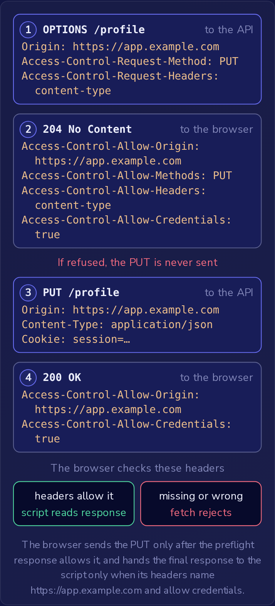

位于 `https://app.example.com` 的单页应用（SPA）用 `fetch('https://api.example.com/profile')` 调用位于 `https://api.example.com` 的 API。
API 的日志显示请求已到达，API 也发送了响应，但脚本却始终看不到它：`fetch` 以 `TypeError` 被拒绝，浏览器控制台报告了 CORS 错误。
浏览器发送了请求，收到了响应，然后不让脚本读取该响应，因为 API 从未表示 `https://app.example.com` 可以读取它。
浏览器所应用的规则是**同源策略**（same-origin policy），而 **CORS** 是服务器用来为该策略设置例外的一组响应头。

### 源

**源**（origin）是一个 URL 的协议（scheme）、主机（host）和端口（port）三者合在一起。
对于 `https://app.example.com`，协议是 `https`，主机是 `app.example.com`，端口是 443：未指明端口的 URL 使用其协议的默认端口，`https` 是 443，`http` 是 80。
只有三者全部匹配，两个 URL 才有相同的源。
路径和查询字符串不属于源，所以 `https://app.example.com/reports?page=2` 与该 SPA 同源。
以下这些则不同源：

- `http://app.example.com`：协议是 `http`，不是 `https`。
- `https://app.example.com:8443`：端口是 8443，不是 443。
- `https://api.example.com` 和 `https://example.com`：主机不同。共享域名 `example.com` 并不会使它们成为同一个源。

### 同源策略阻止了什么

脚本以加载它的页面的源运行。
同源策略允许该脚本向其他源发送请求，但除非对方的源允许，否则不让它读取响应。
当 SPA 的脚本调用 API 时，浏览器会给请求加上 `Origin: https://app.example.com`。
这个头由浏览器自己写入，脚本无法更改。
API 像处理任何其他请求一样处理该请求并发送它的响应。
只有到这时，浏览器才会决定脚本是否可以读取它。
如果响应不允许，脚本就会得到开头提到的那个错误，而 API 所做的一切已经完成。

该策略保护的是用户。
人们在同一个浏览器中会保持登录许多网站，没有这个策略的话，他们打开的任何页面都可以向这些网站请求他们的账户页面并读取回复。

### 用 CORS 允许读取

**CORS**（Cross-Origin Resource Sharing，跨源资源共享）让服务器可以为它所选择的源放宽同源策略。
服务器在响应中发送 **`Access-Control-Allow-Origin`**，指明哪个源的脚本可以读取该响应：

```http
Access-Control-Allow-Origin: https://app.example.com
```

浏览器把该值与调用页面的源比较，只有匹配时才把响应交给脚本。
值 `*` 允许所有源读取。
没有此响应头的响应，如开头那个 API 的响应，任何其他源的脚本都无法读取。

该响应头随响应到达，此时 API 已经收到并处理了请求，所以它无法阻止该请求到达 API。
浏览器强制执行它，是为了保护自己的用户免受其他页面的侵害。
非浏览器的客户端从不执行这项检查：curl，或攻击者自己服务器上的脚本，可以发送任何它想发的请求，带任何 `Origin` 值或不带，并读取完整的响应，无论 `Access-Control-Allow-Origin` 怎么写。
严格的 CORS 设置限制的是运行在受害者浏览器中的其他网站脚本能读取什么。
拒绝其他所有人，是 API 自身对“谁已登录、可以做什么”所做检查的职责。

### 简单请求与预检请求

**简单请求**（simple request）是 HTML 表单本来就能发送到任何网站的请求：一个 `GET`、`HEAD` 或 `POST`，除浏览器视为安全的少数几个头之外没有其他头，并且 `Content-Type`（如果有的话）为 `application/x-www-form-urlencoded`、`multipart/form-data` 或 `text/plain`。
浏览器会立即发送简单请求，并在事后检查响应，如开头所示。

任何其他跨源请求都会先进行**预检**（preflight）：浏览器向同一个 URL 发送一个 `OPTIONS` 请求，指明真正的请求将使用的方法和头，服务器则在 `Access-Control-Allow-Origin`、`Access-Control-Allow-Methods` 和 `Access-Control-Allow-Headers` 中回应它所允许的内容。
`PUT`、`PATCH` 或 `DELETE` 会被预检，带有 `Content-Type: application/json` 或带有 `Authorization` 等头的 `POST` 也会。
只有预检响应允许时，浏览器才发送真正的请求；预检被拒绝时，真正的请求根本不会离开浏览器。
Cookie 在判定请求属于哪一类时不起任何作用。

简单请求跳过预检，是因为在 CORS 出现之前，表单就可以向任何网站提交，所以服务器早已在接收来自其他网站的这类请求。
在 CORS 之前，页面没有办法向另一个网站发送 `PUT` 或标有 `Content-Type: application/json` 的请求，所以尚未选择加入的服务器在收到这类请求之前会先被询问。

SPA 保存用户资料所用的请求需要预检，原因有两个，即它的方法和它的内容类型：

```javascript
await fetch('https://api.example.com/profile', {
  method: 'PUT',
  headers: { 'Content-Type': 'application/json' },
  body: JSON.stringify({ displayName: 'Ada' }),
  credentials: 'include'
});
```



只有预检响应允许之后，浏览器才会发送 PUT；只有最终响应的头指明了 https://app.example.com 并允许凭据时，浏览器才会把它交给脚本。

### 凭据与允许列表

API 通过会话 cookie 识别已登录用户。
除非调用设置了 `credentials: 'include'`（如上面那个调用），否则 `fetch` 不会向其他源发送任何 cookie。
带 cookie 发送的请求就是带**凭据**（credentials）的请求，浏览器只有在两个更严格的条件下才允许脚本读取其响应：

- `Access-Control-Allow-Origin` 指明确切的源 `https://app.example.com`。包含凭据时不允许使用通配符 `*`；在 `*` 之下，浏览器会拒绝让脚本读取响应。
- 响应还带有 `Access-Control-Allow-Credentials: true`。

对于经过预检的调用，预检响应（上面的第 2 步）也需要同时具备这两项。

`Access-Control-Allow-Origin` 只能是一个源或 `*`，绝不能是列表，所以被多个网站调用的 API 必须在每次请求时选择该值。
在 Node.js 处理程序中，其中 `req` 是传入的请求，`res` 是正在构建的响应，捷径是复制收到的任何 `Origin`：

```javascript
const origin = req.headers.origin;
if (origin) {
  res.setHeader('Access-Control-Allow-Origin', origin);
  res.setHeader('Access-Control-Allow-Credentials', 'true');
}
```

这会带着凭据允许所有源。
用户访问的任何网站上的脚本都可以用 `credentials: 'include'` 调用该 API，并且只要浏览器让会话 cookie 随该请求发出，就能读取已登录用户的响应：他们的资料、他们的订单，以及 API 返回的任何内容。
OWASP 把允许不可信源读取数据的 CORS 策略归入 A01:2025 访问控制失效（Broken Access Control）。

修复只改变一个条件，使得只有当源在允许列表中时才回显它：

```javascript
const allowedOrigins = ['https://app.example.com'];
const origin = req.headers.origin;
if (allowedOrigins.includes(origin)) {
  res.setHeader('Access-Control-Allow-Origin', origin);
  res.setHeader('Access-Control-Allow-Credentials', 'true');
}
res.setHeader('Vary', 'Origin');
```

SPA 得到这两个头并读取它的响应；其他每个源两者都得不到，浏览器会不让该源的脚本读取响应。
`Vary: Origin` 告诉缓存响应取决于 `Origin` 头，所以为某个源缓存的副本不会提供给另一个源。
要比较完整的源：像 `origin.endsWith('example.com')` 这样的检查也会接受 `https://attackerexample.com`。
通配符 `*` 仍然适合不使用 cookie 的公开 API，因为在那里任何网站读取的本来就是公开数据。
