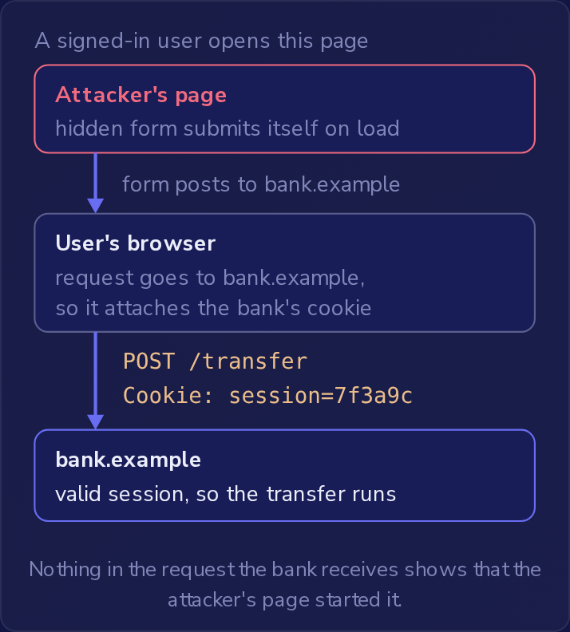

浏览器根据请求要去的地方，而不是根据哪个页面发出请求，来选择该请求携带的 cookie。
除非 cookie 的 `SameSite` 属性把它拦下（下文详述），否则发往 `bank.example` 这家网上银行的请求会携带 `bank.example` 设置的 cookie，即使该请求是由另一个网站上的页面发起的。
**跨站请求伪造**（cross-site request forgery，CSRF）把这一点变成了攻击：另一个网站上的页面让已登录用户的浏览器向银行发送请求，会话 cookie 随之而去，银行就按一个用户从未打算发送的请求行事。

值得伪造的请求是**状态变更请求**（state-changing requests），即服务器在请求到达时会改变某些东西的请求，例如转账或更新电子邮件地址，而不只是读取数据。
在 `bank.example` 上，转账表单发送带有收款人和金额的 `POST /transfer`，银行通过会话 cookie 识别用户。
目前银行用 `SameSite=None` 设置该 cookie，所以该属性不会拦下由其他网站发起的请求。
攻击者的页面只需要这些：

```html
<form action="https://bank.example/transfer" method="POST">
  <input type="hidden" name="to" value="attacker-account">
  <input type="hidden" name="amount" value="5000">
</form>
<script>document.forms[0].submit();</script>
```

这个表单没有可见字段，脚本在页面加载后立即提交它，所以已登录的用户只要打开该页面，就会在没有输入或点击任何东西的情况下向银行发送一个 POST。
会话 cookie 随之而去，服务器找到有效的会话，转账就成功了。
银行的访问检查对一个用户从未选择的操作放行了，这就是为什么 OWASP 把 CSRF 归入 A01:2025 访问控制失效（Broken Access Control）。



银行收到的请求中，没有任何迹象表明是攻击者的页面发起了它。

攻击者的页面从不接触 cookie。
它无法读取属于 `bank.example` 这个不同源的 cookie，而且也不需要。
把 cookie 标记为 `HttpOnly` 在这里没有任何改变。
`HttpOnly` 让 cookie 不出现在 `document.cookie` 中，因此没有脚本能读取它。
它对浏览器把 cookie 附加到哪些请求上没有影响，伪造的 POST 照样携带它。

攻击者也不需要银行的响应。
同源策略阻止攻击者的页面读取 `bank.example` 发回的内容，但并不阻止浏览器发送表单提交，而钱在服务器处理它时就已经转走了。
`/transfer` 上严格的 CORS 策略也没有帮助，原因相同：CORS 对从另一个网站提交的表单没有发言权，无论银行的 CORS 设置如何，浏览器都会发送它。

### 通过 GET 变更状态

银行一个较旧的端点通过 `GET /account/email?new=...` 更改账户的电子邮件地址。
银行的开发者认为这是安全的，因为没有任何公开页面链接到它，但未被链接的 URL 并不是秘密。
任何有账户的人都可以在自己浏览器的流量中看到它，然后攻击者就可以把它放进自己的页面。
它甚至不需要表单：

```html

```

加载该页面会让浏览器在没有任何点击的情况下请求那个“图片”，只要浏览器在跨站请求中发送该 cookie，会话 cookie 就会随之而去。
服务器更改了电子邮件，而页面显示的是一张损坏的图片。
让标签页跳转到同一个 URL 的脚本同样有效。
状态变更属于 POST（或 PUT 和 DELETE），绝不属于 GET。
POST 也可以被伪造，如隐藏表单所示，所以这种变更仍然需要下面的防御措施。

### SameSite 属性

`SameSite` 决定浏览器是否把 cookie 附加到跨站请求上，即由与 cookie 所属站点不同的站点上的页面发起的请求。
站点（site）比源宽松：`bank.example` 和 `login.bank.example` 是两个源但属于同一个站点，而攻击者的页面则完全在另一个站点上。
银行在创建 cookie 的 `Set-Cookie` 头中设置该属性，紧挨着它的其他属性，如 `Set-Cookie: session=7f3a9c; HttpOnly; SameSite=Lax`。
它取三个值之一：

- `SameSite=Strict`：浏览器从不把 cookie 附加到跨站请求上。这包括从网页邮箱收件箱或搜索结果中点击链接前往银行的用户，他们落地的第一个页面会显示为未登录。
- `SameSite=Lax`：在跨站请求中，浏览器只把 cookie 附加到顶层 GET 导航上，即在标签页中加载新页面的 GET，例如点击链接。隐藏表单的 POST 和 `` 请求都不带它。攻击者页面上让标签页跳转到电子邮件 URL 的脚本发起的正是这种导航，所以 Lax 会让 GET 端点保持敞开。
- `SameSite=None`：该属性什么也不拦，所以 cookie 可以随任何跨站请求发送，当另一个网站必须使用该 cookie 时（例如嵌入的小组件）就需要这样。浏览器只在 cookie 同时标有 `Secure` 时才接受它。它对 CSRF 不提供任何保护：银行的 cookie 以这种方式设置时，隐藏表单的 POST 会携带它。

当 cookie 完全没有 `SameSite` 属性时，各浏览器的做法不同：有些把它当作 Lax 对待，有些仍会把它附加到跨站表单提交上。
省略它只保护了银行的一部分用户而不是全部，所以要自己设置该值。
对于会话 cookie，这意味着 Lax 或 Strict。

### 防伪令牌

SameSite 取决于每个浏览器的行为，而且 Lax 仍然放行顶层 GET，所以它最适合作为第二层防护。
主要的防御是服务器自己检查的那一种：**防伪令牌**（anti-forgery token，也称 CSRF 令牌），这是服务器为用户的会话签发的不可猜测的秘密值，写入服务器自己的表单，并在每个状态变更请求上检查。

```html
<form action="/transfer" method="POST">
  <input type="hidden" name="csrf_token" value="b81f0c9e2d47a6f3">
  <input name="to">
  <input name="amount">
  <button>Send</button>
</form>
```

没有携带匹配值的转账请求会被拒绝。
攻击者的隐藏表单可以包含一个 `csrf_token` 字段，但无法填入该值：令牌位于 `bank.example` 提供的页面中，而同源策略阻止攻击者的页面读取那个页面。
伪造的 POST 仍然携带会话 cookie，却依然被拒绝，因为失败的检查是令牌检查。
同时也要保留 SameSite，因为它还能覆盖任何有人忘了做令牌检查的状态变更端点。

令牌只能阻止其他网站上的页面。
跨站脚本漏洞会让攻击者的脚本在银行自己的页面上、在银行的源中运行。
该脚本可以直接从表单中读取 `csrf_token`，因为令牌是页面 HTML 的一部分，而不是 cookie，然后发送一个能通过检查的转账请求。
CSRF 和 XSS 是不同的漏洞，有不同的修复方法，但 XSS 漏洞会击败 CSRF 防御，所以防伪令牌的强度只取决于页面对 XSS 的防护。
