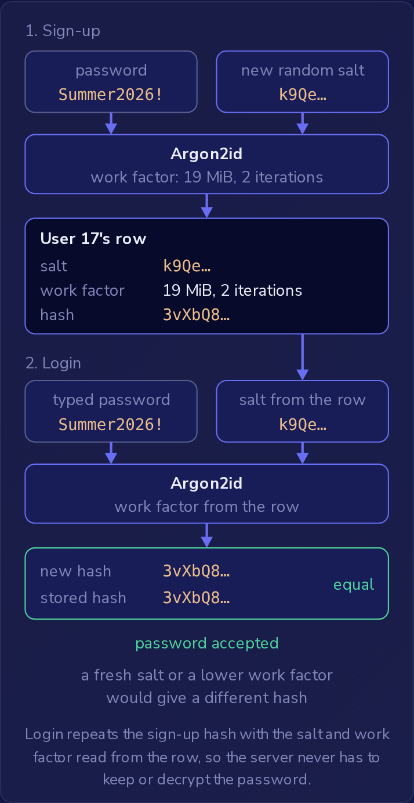

注册服务在每次登录时都要校验密码，但从不需要把密码读回来。
服务用什么来代替密码进行存储，决定了数据库备份泄露时攻击者能拿到什么。
假设两个用户都选了 `Summer2026!`，服务有四种存储方式：明文、用保存在应用配置里的密钥加密、不加盐的 SHA-256 摘要、以及带每用户盐的 Argon2id 哈希。
明文让攻击者不费吹灰之力就拿到所有密码。
只有 Argon2id 这种形式，才让攻击者除了一次一个账户地缓慢猜测之外一无所获。
OWASP 在 A07:2025 认证失败（Authentication Failures）下列出了明文、加密和弱哈希的密码存储方式。

### 对密码做哈希

**哈希函数**（hash function）把任意输入变成一个固定大小的值，称为**摘要**（digest），通常也直接叫哈希。
SHA-256 总是产生 32 字节，写成 64 个十六进制字符，不论是 6 个字符的密码还是 60 个字符的密码，因此摘要不会透露密码的长度。
它不使用密钥，相同的输入总是得到相同的摘要。
它还是**单向的**（one-way）：没有任何密钥或解码步骤能把摘要还原成输入。
唯一的回头路是猜一个密码，对它做哈希，再比较两个摘要。

这正是登录校验所需要的全部：注册时服务器存储摘要，登录时对用户输入的内容做哈希，并把结果与存储的摘要比较，因此原始密码从不被保存。

相同输入每次都得到相同摘要，这同样是不加盐 SHA-256 这一列的弱点。
两个用户的行里存的是同一个摘要：

```text
user_id  password_sha256
17       a5c95e887dbf1c0a49fd...
42       a5c95e887dbf1c0a49fd...
```

在开始猜之前，攻击者就能看出账户 17 和 42 使用了相同的密码，一次正确的猜测就能同时破解这两个账户，以及所有选了同一密码的其他账户。
由于 `Summer2026!` 在任何地方都得到那个摘要，攻击者还会保存预先为数百万个常见密码计算好的摘要表，在这样的表中查找泄露的摘要完全不需要做哈希。

### 每个用户一个盐

**盐**（salt）是服务器在注册时为每个用户生成的随机值，与哈希存放在一起。
服务器把密码和盐一起做哈希，因此 `Summer2026!` 配上用户 17 的盐和配上用户 42 的盐，会得到两个不同的哈希。
盐是随机的，不是由密码生成的，而且它不是秘密：服务器在每次登录时都要读取它，所以它和哈希放在同一行，攻击者随备份一起拿到它。
知道盐并不能还原任何东西，它只是告诉攻击者每次猜测要用什么来做哈希。

盐有两个作用，只有**每用户**（per-user）的盐才能同时做到。
任何盐都会让泄露之前计算好的表失效，因为没有人事先用这个盐计算过摘要。
为每个用户使用单独的盐，还会让相同的密码得到不同的哈希，因此攻击者必须针对每个账户把每次猜测重新哈希一遍。
整张表共用一个盐，创建一次后保存在设置表里，就失去了第二个作用：相同密码的用户仍然有相同的哈希，用该盐对每次猜测只做一次哈希，就能同时与所有账户比对。

### 慢速密码哈希

盐对单次猜测的成本没有任何影响。
SHA-256 是一种被设计为快速的安全哈希函数，这适合校验下载的文件，却不适合用于密码：一块当前的 GPU 每秒能计算数十亿次 SHA-256 哈希。
面对加盐的 SHA-256 这一列，攻击者以这个速度用每个用户的盐对猜测做哈希，像 `Summer2026!` 这样的弱密码仍然会很快被攻破，一次一个账户。
攻击者无法从加盐的摘要中去掉盐来得到不加盐的 SHA-256 摘要，因为盐是与密码一起送入哈希函数的。

密码哈希是故意做慢的。
Argon2id、scrypt、bcrypt 和 PBKDF2 都带有一个**工作因子**（work factor），用来设定一次哈希的成本：迭代次数，对于 Argon2id 和 scrypt 还包括内存用量。
OWASP 对 Argon2id 的最低要求是 19 MiB 内存、2 次迭代、并行度 1；对 bcrypt 则是工作因子 10。
工作因子适用于 Argon2id 计算的每一个哈希，无论输入的是什么盐。
登录的用户只需支付一次这个成本，不到一秒。
攻击者则要为针对每个哈希的每一次猜测都支付这个成本。

服务器把盐和工作因子与哈希一起存放在用户的行中，因为同一个密码用不同的盐或不同的工作因子哈希，会得到不同的哈希。
登录时它读取该行，用该行的盐和工作因子对输入的密码做哈希，并把结果与存储的哈希比较。
登录时如果使用新的盐或更低的工作因子，就会产生不同的哈希，从而拒绝正确的密码。



登录用从该行读取的盐和工作因子重复注册时的哈希过程，因此服务器无需保存或解密密码。

把工作因子保存在每一行里，也让团队能够随着硬件变快而提高它。
新的哈希使用更高的设置，旧的行仍按旁边存储的设置校验，每个旧行会在其用户下次登录时用新设置重新哈希。

**慢速哈希**（slow hash）让猜测变得昂贵，但绝不会让它变得不可能。
排在攻击者猜测列表前列的密码，无论每次猜测多慢，都会在寥寥几次猜测后被找到，这就是注册表单还要拒绝已泄露密码的原因。

### 用加密代替哈希

用密钥对每个密码加密乍看之下同样安全，因为没有密钥的话，泄露的备份里只有不可读的值。
但加密在设计上就是可逆的：持有密钥的人可以一次性把每个存储的值还原成原始密码，不需要任何猜测。
运行中的应用需要这个密钥来校验每次登录，所以它放在服务器上的应用配置里，之后的入侵或被复制的配置文件都可能暴露它。
每隔几个月更换一次密钥并不会改变什么，因为应用始终持有能解密每一行的密钥。
Argon2id 哈希没有可被窃取的密钥，所以拿到备份的攻击者只能猜测，并为每次猜测支付工作因子的成本。

### NIST 的密码规则

存储方式决定了一次泄露的代价；注册表单则决定了密码一开始有多容易被猜到。
美国标准机构 NIST 在 SP 800-63B 中发布了它的密码规则，当前的第 4 版（2025 年 7 月）改变了许多团队仍在使用的规则。
上一版允许任何密码只有 8 个字符。
第 4 版要求：

- **密码长度**（password length）：当密码是唯一的登录因素时至少 15 个字符，所以更短的密码无论混用了多少种字符类型都会被拒绝。8 个字符只在密码与第二个因素一起使用时才是最低要求。表单应当允许至少 64 个字符的密码。
- 对每个新密码，对照已泄露密码和常用密码的列表进行检查，无论多长，只要在列表上就拒绝。
- 没有组成规则，所以 15 个不在列表上的小写字母就是可接受的密码。要求大写字母、数字和符号并不会让密码难以猜测，因为人们应对这些规则的方式是可预测的：`Summer2026!` 能通过这样的规则，而它恰恰是猜测列表早早就会尝试的那类密码。
- 不按计划强制更改，例如每 90 天一次，这会促使人们做可预测的小改动。当有证据表明密码已泄露时，仍然需要更改。
