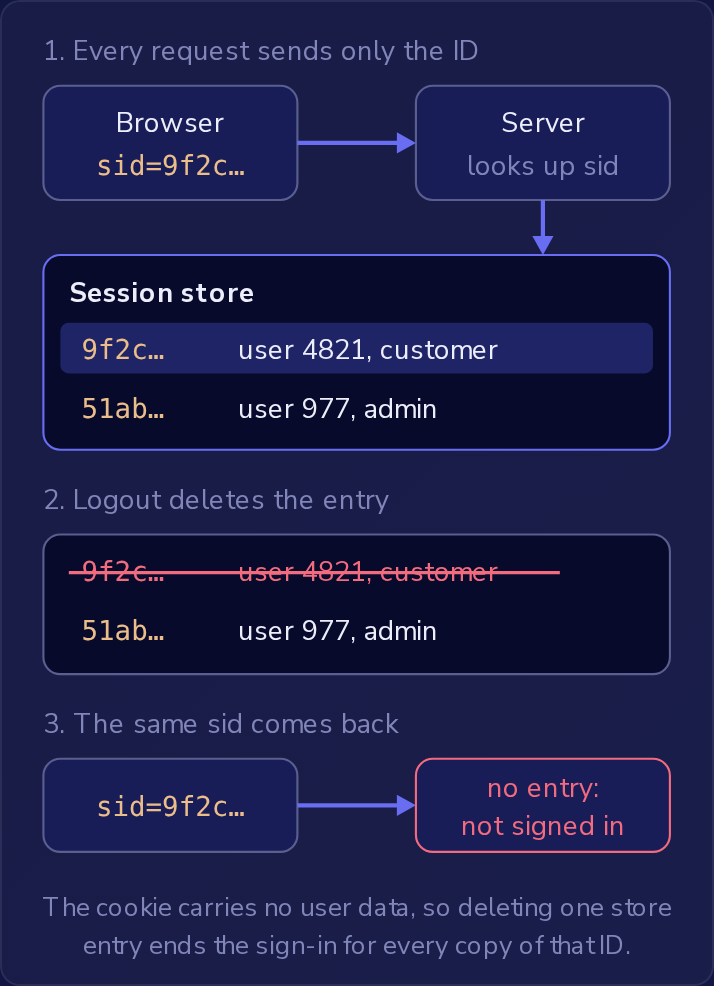
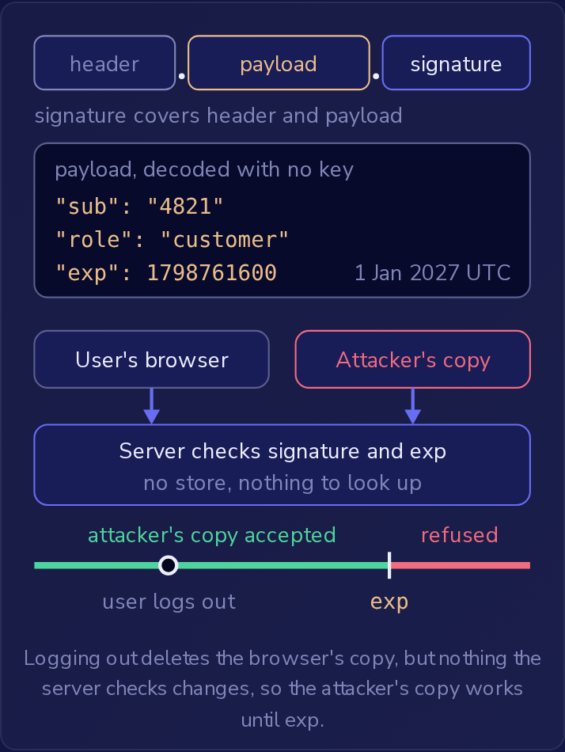

密码校验通过之后，应用必须在之后的每个请求中认出同一个用户，而不必再次索要密码。
两个示例应用以不同的方式做到这一点。
会话应用使用**服务端会话**（server-side session）：浏览器只持有一个随机 ID，其余一切由服务器保管。
令牌应用使用 **JSON Web Token**（JWT）：服务器把用户的详细信息写入一个签名令牌，交给浏览器，并且不保留任何记录。
服务器保留什么，决定了登出、修改密码或令牌副本被盗会对登录状态造成什么影响。

### 每个应用如何识别请求

会话应用用如下响应头让用户登录：

```http
Set-Cookie: sid=<128-bit random value>; HttpOnly; Secure; SameSite=Lax
```

`sid` 中的**会话 ID**（session ID）是 128 个随机比特，可能的取值多到无法猜测，并且它不携带任何用户数据。
服务器把这些数据保存在它的**会话存储**（session store）中，每个会话一条记录，以会话 ID 为索引，并记录它属于哪个用户。
每个请求到来时，服务器都在存储中查找 `sid`。
没有记录的 ID 就是未登录，因此删除一条记录会立即结束该会话。



cookie 不携带用户数据，所以删除一条存储记录，就会结束该 ID 的所有副本的登录状态。

值后面的三个属性限制谁能读取 cookie 以及浏览器何时发送它：

- `HttpOnly` 让 cookie 不出现在 `document.cookie` 中，所以页面上的脚本无法读取会话 ID。浏览器仍会把 cookie 附加到发往应用的请求上，包括脚本发起的 `fetch` 调用。
- `Secure` 让浏览器只在 `https://` 请求上发送该 cookie，绝不在普通的 `http://` 上发送，因为在 `http://` 上网络中的任何人都能读到它。
- `SameSite=Lax` 阻止 cookie 出现在其他站点发起的请求中：该站点从应用加载的图片、它发起的 `fetch`、它提交的表单。当其他站点通过一个在标签页中加载新页面的 GET 把用户带到应用时，例如点击一个链接，它仍会发送 cookie，所以用户到达时是已登录状态。SameSite 只涉及来自其他站点的请求，对应用自己页面上的脚本没有任何约束力。

令牌应用则返回一个 JWT：由点号连接的三个 **Base64URL** 字符串，即 `header.payload.signature`。
Base64URL 用字母、数字、`-` 和 `_` 来表示字节，使其能放进 URL 或请求头中，任何人都可以不用密钥把它还原成原始字节。
payload 解码后得到令牌的**声明**（claims），即它对用户做出的陈述：

```json
{"sub":"4821","role":"customer","exp":1798761600}
```

`sub`（subject，主体）是令牌所指向的用户。
`role` 是这个应用自选的声明；应用可以在标准声明旁边添加自己的声明。
`exp` 是过期时间，它是一个固定的时刻，而不是从登录起算的时长，以自 1970 年 1 月 1 日 UTC 起的秒数表示：1798761600 是 2027 年 1 月 1 日 00:00 UTC。

**签名**（signature）由服务器对编码后的 header 和 payload 计算得出，使用只有服务器持有的密钥。
每个请求到来时，服务器检查签名是否与 header 和 payload 匹配，并检查当前时间是否早于 `exp`，然后直接从 payload 中取出 `sub` 和 `role`。
不需要查找任何东西。
签名覆盖了 header 和 payload 的每个字节，所以修改任何声明都会破坏匹配：把 `sub` 改成 `4822` 并重新编码 payload 的用户，得到的令牌会被服务器拒绝，因为只有服务器的密钥才能生成与新 payload 匹配的签名。
出于同样的原因，要得到更晚的 `exp` 就意味着要从服务器获取新令牌。

签名证明 payload 未被改动，但它不隐藏任何东西。
任何持有令牌的人都能解码每一个声明，无论在 `exp` 之前还是之后，所以 payload 里不应放任何私密内容，例如家庭住址。

在生产环境中，服务器检查的不止签名和 `exp`，它会使用一个维护良好的 JWT 库，只接受自己预期的签名算法，并检查谁签发了令牌以及令牌是给哪个应用的。
这些检查都无法区分被盗的副本和原件，所以副本在 `exp` 之前仍然有效。



登出会删除浏览器中的副本，但服务器检查的任何内容都没有改变，所以攻击者的副本在 exp 之前一直有效。

### 登出、修改密码、被盗与 XSS

**撤销**（revocation）指在凭据过期之前就终结它。
会话应用通过删除会话的存储记录来撤销会话，登出时就会这样做。
在这两个应用中，新密码本身都不会终结任何登录状态，但在那一刻会话应用还可以删除属于该用户的所有记录，从而切断使用复制来的 `sid` 的攻击者。

令牌应用在服务器上没有任何可删除的东西。
登出会删除浏览器中的 JWT 副本，而任何其他副本在 `exp` 之前仍会通过签名和 `exp` 检查。
修改密码后签发新令牌，旧令牌仍然有效；修改用户的数据库记录也影响不到已经签发的令牌，因为它们的声明在签名时就已固定。
要提前撤销 JWT，服务器终究还是需要查找，例如在每个请求上检查一个已撤销令牌的拒绝列表。
这就是通常的建议是让令牌保持**短生命周期**（short-lived）的原因，即 `exp` 设在签发后几分钟而不是几天：被盗的副本很快就会失效，不过这样应用就必须频繁签发新令牌。

被复制的 cookie 值或令牌可以在任何机器上使用，因为无论 Secure 属性还是签名，都不会说明发送者是谁。
被盗的 `sid` 在服务器删除其记录之前一直有效，被盗的 JWT 则在其 `exp` 之前一直有效。

XSS 漏洞会让攻击者的脚本在应用的页面上运行。
在会话应用中，`HttpOnly` 能阻止脚本读取 `sid` 并把它发送出去以便在另一台机器上使用，但脚本的 `fetch` 调用会带上 `sid`，所以页面打开期间它可以冒充用户行事。
它所做的事情在页面关闭后仍会持续：如果它把账户的电子邮件地址改成攻击者的，下一封密码重置链接就会发给攻击者，攻击者可以接管该账户。

当令牌应用把 JWT 保存在 `localStorage` 中并通过 `Authorization` 头发送时，页面上的任何脚本都能读取令牌并把它发送到攻击者的服务器，在那里它直到 `exp` 都有效。
不把令牌放在 cookie 中确实能阻止来自其他站点的伪造请求，因为浏览器从不自动附加它，但应用自己页面上的脚本附加它的方式与应用完全一样。
HTTPS 保护的是连接，而不是页面存储的内容，而 `HttpOnly` 只适用于 cookie。

`localStorage` 不是推荐用来保存登录凭据的地方。
浏览器把凭据保存在哪里，与服务器是否保留会话存储，是两个独立的决定：JWT 也可以保存在 `HttpOnly` cookie 中，在那里 XSS 脚本可以像使用 `sid` 一样使用它，但无法读取它。
