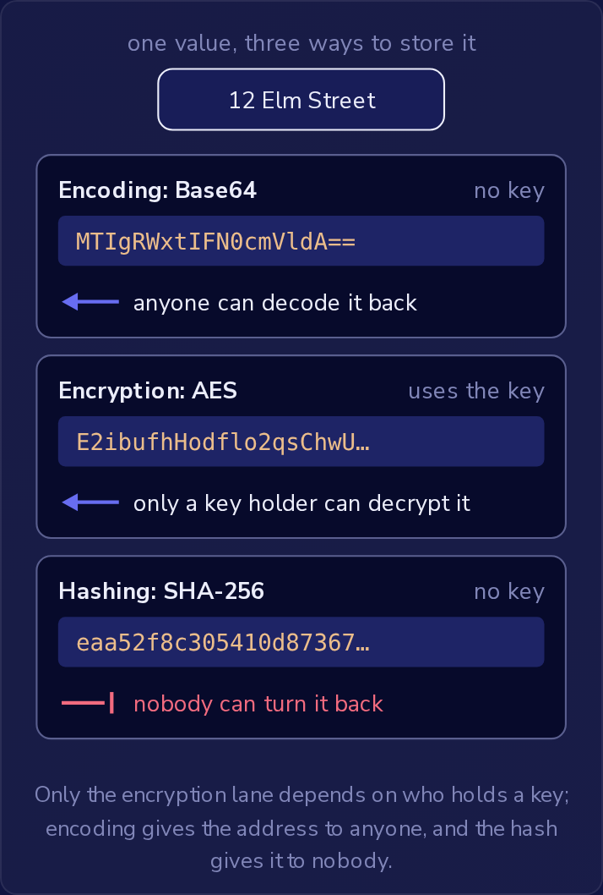

Base64 字符串、AES 加密的值和 SHA-256 哈希看起来都像随机文本，只看配置文件或数据库列，你分辨不出眼前的是哪一种。
区分它们的关键在于：谁能把存储的值还原成原始内容。
**编码（encoding）** 任何人都可以还原。
**加密（encryption）** 只有持有密钥的人才能还原。
**哈希（hashing）** 任何人都无法还原。
因此，为某项工作选择哪一种，就要问：谁必须能够取回原始内容，是任何人、只有密钥持有者，还是没有人。



只有加密这一条路径取决于谁持有密钥；编码把地址交给任何人，而哈希把地址交给没有人。

### 编码只改变格式

**Base64** 是一种编码。
它使用 64 个可打印字符（`A` 到 `Z`、`a` 到 `z`、`0` 到 `9`、`+` 和 `/`）重写任意字节，并以 `=` 作为末尾的填充，这样二进制数据就可以放到只能容纳文本的地方。
JSON 字符串无法容纳 PDF 或图片的原始字节，因此 API 会把 Base64 文本放进字符串，接收方再将其解码回完全相同的字节。
JWT 的 payload 使用 Base64URL，这是一种用 `-` 和 `_` 代替 `+` 和 `/` 的变体，这就是为什么任何持有令牌的人都可以读取其中的声明（claims）。

Base64 不使用密钥。
字母表是公开的，每种常见语言的标准库都可以对其解码：

```javascript
btoa("Summer2026!")        // "U3VtbWVyMjAyNiE="
atob("U3VtbWVyMjAyNiE=")   // "Summer2026!"
```

解码会逐字符地还原输入，不需要任何机密，不需要搜索，也不需要特殊程序。
配置文件中经过 Base64 编码的值，对任何能打开该文件的人来说，与明文一样可读。
OWASP 的 A04:2025 Cryptographic Failures 类别把针对密码的弱编码列为其弱点之一，而由 `U3VtbWVyMjAyNiE=` 这类值构成的密码列正是如此。

### 加密把保护交给密钥

**加密**将数据转换为**密文（ciphertext）**，即没有密钥就无人能读取的字节，而密钥可以把密文还原成数据。
使用最广泛的算法是 **AES**，它属于**对称加密（symmetric encryption）**：同一个共享密钥既负责加密也负责解密。
加密适用于之后必须完整读取的数据。
打开客户记录的客服人员需要客户填写的街道地址，因此应用用 AES 加密存储该地址，并在每次需要时用密钥解密。

解密只需要密文和密钥，可以在任何机器上、任何实现了 AES 的程序中进行；它并不绑定于执行加密的服务器。
因此，加密保护数据不被没有密钥的人读取，却无法防范持有密钥的人，所以你把密钥存放在哪里，决定了加密究竟保护了什么。
如果地址密钥存放在别处，数据库的副本只会显示密文。
如果把密钥放在应用的配置文件中、紧挨着数据库连接字符串，它就会跟着该文件去往任何地方：一个同时包含数据库和配置文件的备份压缩包，会让拿到它的人获得所有地址，无需搜索或破解。
密钥应当放在数据不会流转到的地方，这样一方的副本就不会同时成为另一方的副本。

密文是原始字节，因此应用常常把它以 Base64 形式存储或发送。
解码该 Base64 得到的是密文，而不是地址；要读取地址仍然需要密钥。

### 哈希没有回头路

SHA-256 这类哈希函数会读取其全部输入（例如文件内容的每一个字节），并返回固定大小的哈希值，相同的输入每次得到的结果都相同，并且不使用密钥。
没有任何东西能把哈希还原成它的输入：没有密钥，没有盐（salt），甚至连计算它的应用也做不到。
因此，哈希只适合那些永远不需要原始内容的检查。

其中一种检查是发现文件是否被更改。
下载页面会列出其安装程序的 SHA-256 哈希，任何人都可以对自己下载的副本计算哈希并进行比较，无需密钥或机密。
只要更改一个字节，得出的哈希就会完全不同，既没有任何可见的规律把它与列出的哈希联系起来，也没有任何字符标明更改发生的位置。

另一种是检查密码，例如加盐的密码哈希：登录时用用户保存的盐对输入的密码计算哈希，并将结果与存储的哈希比较，因此服务器永远不需要密码本身。
得知被哈希的密码的唯一办法是猜测，对每个猜测计算哈希并进行比较。

加密的密码在泄露的表中看起来同样安全，因为没有密钥时，表中只显示密文。
但是 AES 是双向的：持有密钥的人可以一次性解密每个存储的密码。
客服人员把忘记的密码读回给用户，用的就是这种能力，任何从配置文件中复制出密钥的人同样可以做到。
密码哈希没有密钥，因此没有人（包括应用本身）能从存储中读回密码。
想要取回原始内容，正是一个值被加密而不是被哈希的标志，而密码从不需要这样：登录比较的是哈希，忘记密码的用户可以设置新密码。

哈希也不能替代应用必须发送的值。
一个每次调用都要传递合作方 API 密钥的应用需要真正的密钥，因为合作方要检查它；其哈希是另一个字符串，合作方会拒绝它。
