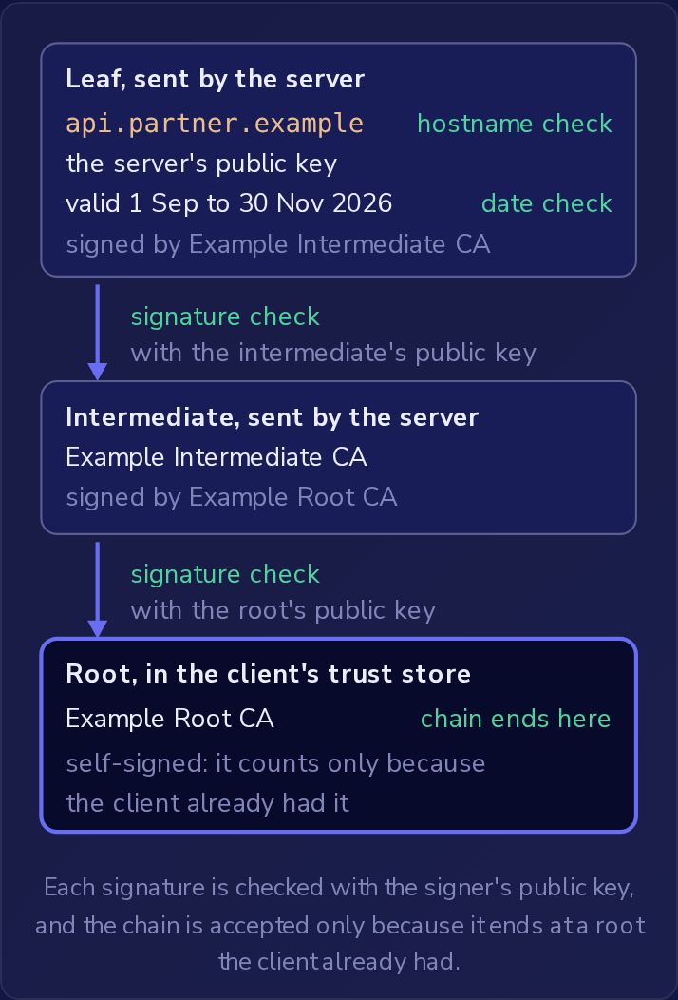

HTTPS 是通过 TLS 发送的 HTTP，TLS 是一种对客户端与服务器之间的连接进行加密的协议。
但是，如果另一端是错误的服务器，加密就起不到任何保护作用：加密给攻击者的流量，攻击者是可以读取的。
因此，在 TLS 客户端发送请求之前，它会检查服务器的**证书（certificate）**，以确认自己在与谁通信。
这项检查建立在公钥和私钥之上。

### 密钥、证书与信任链

AES 这类对称加密使用同一个共享密钥进行加密和解密。
使用共享机密签名的 JWT（`HS256` 算法）的工作方式与此相同：服务器用一个机密生成签名并校验签名，因此任何能够校验签名的人也能生成签名。
公钥密码学通过一对密钥把这两项工作分开，使用 `RS256` 或 `ES256` 签名的 JWT 就用到这种密钥对。
**私钥（private key）** 由其所有者保管。
**公钥（public key）** 可以与任何人共享。
用私钥签名的数据带有**签名（signature）**，任何持有公钥的人都可以校验，只要已签名数据中有哪怕一个字节发生改变，校验就会失败。
公钥可以校验签名但无法生成签名，并且在任何实际可行的时间内都无法从公钥推算出私钥，这正是公开分发公钥是安全的原因。

证书把公钥与主机名绑定在一起。
它列出一个或多个主机名（例如 `api.partner.example`）、服务器的公钥、起始日期、结束日期，以及签发它的**证书颁发机构（certificate authority，CA）**。
最后是 CA 对上述所有字段的签名，由 CA 的私钥生成。
证书中没有任何内容是加密的；任何人都可以读取每个字段。
签名涵盖这些确切的内容，因此更改主机名或任何其他字段都会使校验失败，而从一张证书复制来的签名与另一张证书也不匹配。

由于任何人都可以读取证书，持有一份副本并不能证明什么。
TLS 连接以握手（handshake）开始，这是一组简短的建立连接的消息交换，在其中，服务器使用与其证书中公钥相匹配的私钥，对这次交换中的数据进行签名。
只有证书副本的服务器无法生成这个签名。

要校验 CA 的签名，客户端需要事先拥有该 CA 的公钥。
浏览器和操作系统内置**信任存储（trust store）**，其中是一组**根（root）**证书，包含它们选择信任的 CA 的公钥。
Node.js 自带一份列表，而 .NET 的 `HttpClient` 使用操作系统的列表。

根证书通常不会亲自签发服务器证书。
根证书签发**中间（intermediate）**证书，再由中间证书签发服务器的证书，后者称为**叶（leaf）**证书。
服务器会把它的叶证书连同中间证书一起发送，客户端沿着**信任链（chain of trust）**校验：先检查中间证书对叶证书的签名，再检查根证书对中间证书的签名，只有当该链终止于其自身信任存储中已有的根证书时，才接受这条链。
根证书是自签名的：它的签名由根自己的私钥生成。
任何人都可以制作这样的证书，因此服务器一并发来的根证书不算数；只有客户端的信任存储才能决定。



每个签名都用签名者的公钥校验，而这条链之所以被接受，只是因为它终止于客户端事先已有的根证书。

### 三项检查，以及将其关闭

**证书验证（certificate validation）** 包含三个部分，其中任何一项失败，客户端都会拒绝连接：

- **信任链**从叶证书通向客户端信任存储中的某个根证书。自签名的叶证书由其所有者自己的密钥签名，而不是由 CA 签名，它没有通向受信任根证书的信任链，因此会被拒绝。
- **主机名**：客户端所连接的主机名列在证书中。一张证书可以列出多个主机名，只要被调用的名称是其中任何一个，检查就通过。`www.partner.example` 的证书并不涵盖 `api.partner.example`，即使两者都位于 `partner.example` 之下。
- **日期**：客户端会拒绝结束日期已过或起始日期尚未到来的证书。在结束日期之前，所有者会续订证书，也就是为相同的主机名获取一张带有新日期的新证书。客户端会像接受其他任何证书一样接受它。

主机名检查把服务器与名称联系在一起。
DNS 只告诉客户端该连接到哪里，而网络路径上的任何人都可以替某个名称作答；证书验证才能证明该服务器确实是 `api.partner.example`。

服务器代码中的 HTTP 客户端默认执行与浏览器相同的检查。
在 Node.js 中，`rejectUnauthorized` 这个 TLS 选项默认为 `true`，.NET 的 `HttpClient` 也以同样的方式验证，因此任何一项检查失败都会使调用以错误而不是警告的形式失败。
检查失败绝不会退回到未加密的连接；请求不会被发送。

通过全部三项检查只证明了一件事：连接是加密到一台持有该确切主机名私钥的服务器的。
浏览器长期以来在地址栏中显示的挂锁图标（当前的 Chrome 在那里显示的是另一种图标），或者通过 HTTPS 加载且没有警告的页面，所表示的就是这个意思，仅此而已。
对于常见的证书，CA 只检查申请者是否控制该域名，从不检查其背后的人是否诚实，因此任何注册了外观相似域名的人都可以为它获得有效证书。
HTTPS 并不表明该网站属于其所模仿的品牌，不表明其内容是安全的，也不表明其表单会把用户输入的内容发送到哪里。

有一个设置会关闭所有检查。
在 Node.js 中是 `rejectUnauthorized: false`：

```javascript
const agent = new https.Agent({ rejectUnauthorized: false });
```

在 C# 中，是返回 `true` 的 `ServerCertificateCustomValidationCallback`：

```csharp
var handler = new HttpClientHandler
{
    ServerCertificateCustomValidationCallback = (request, cert, chain, errors) => true
};
```

该回调会收到 `errors`，它说明了哪些检查失败，但仅由其返回值决定结果。
这两种设置都会接受任何证书：主机名错误的、已过期的、自签名的，或来自未知 CA 的。
网络中间的任何人随后都可以出示自己的证书，客户端会与其完成 TLS。
流量仍然是加密的，但加密给了攻击者，攻击者将其解密、读取、可以更改，并通过第二条连接转发给真正的服务器。
响应中看不出任何异常。

以这种方式构建的测试客户端，在每次运行时、无论在什么网络上运行，都带有同样的暴露风险。
当测试服务器使用自签名证书时，应让客户端信任这一张证书（Node.js 通过 `ca` 选项接收它），并保持其他检查继续运行。

### HSTS 与首次访问

从 `http://` 到 `https://` 的重定向只会在一个纯 HTTP 请求发出之后才发生，而在攻击者控制的网络（例如公共 Wi-Fi）上，该请求可能根本到不了网站。
攻击者用自己的页面来回应它。
没有建立过 TLS 连接，因此没有检查过任何证书，网站拥有证书也不会产生任何影响。

**Strict-Transport-Security** 响应头，简称 **HSTS**，会对每个已经通过 HTTPS 收到该响应头的浏览器取消这个纯 HTTP 请求：

```http
Strict-Transport-Security: max-age=31536000; includeSubDomains
```

- `max-age` 是浏览器保留该规则的时长，以秒为单位：31536000 是 365 天，从携带该响应头的 HTTPS 响应开始计算。之后每个带有该响应头的 HTTPS 响应都会重新开始计时。
- `includeSubDomains` 会把该规则同样应用于每个子域名，例如 `shop.example` 的 `api.shop.example`。

当浏览器持有该规则时，它会在发送任何请求之前，把该网站的每个 `http://` URL 改为 `https://`，因此不存在可供攻击者应答的纯 HTTP 请求。
如果 HTTPS 连接失败，浏览器会显示错误；如果证书未通过验证，它会显示用户无法点击跳过的错误。
HSTS 只决定使用 HTTPS；每个连接仍然要经过完整的证书检查。

当响应头出现在纯 HTTP 响应上时，浏览器会忽略它，因为网络上的任何人都可能在那里添加或剥离它。
所以，从未通过 HTTPS 收到过该响应头的浏览器没有该网站的规则，规则已超过 `max-age` 而失效的浏览器也没有；这两种浏览器都可能被送去攻击者的页面。

对于 HSTS，首次访问的唯一保护是浏览器的**预加载（preload）**列表，这是内置在浏览器中的 HSTS 网站列表。
发送该响应头并不会使网站进入该列表：所有者需要提交域名，列表的要求包括至少 31536000 的 `max-age`、`includeSubDomains`，以及响应头中额外的 `preload` 标记。
网站无需进入该列表，响应头就可以保护已经收到它的浏览器。
有些浏览器现在会优先尝试 HTTPS，或者在加载纯 HTTP 页面之前发出警告，而无需网站发送任何响应头。
