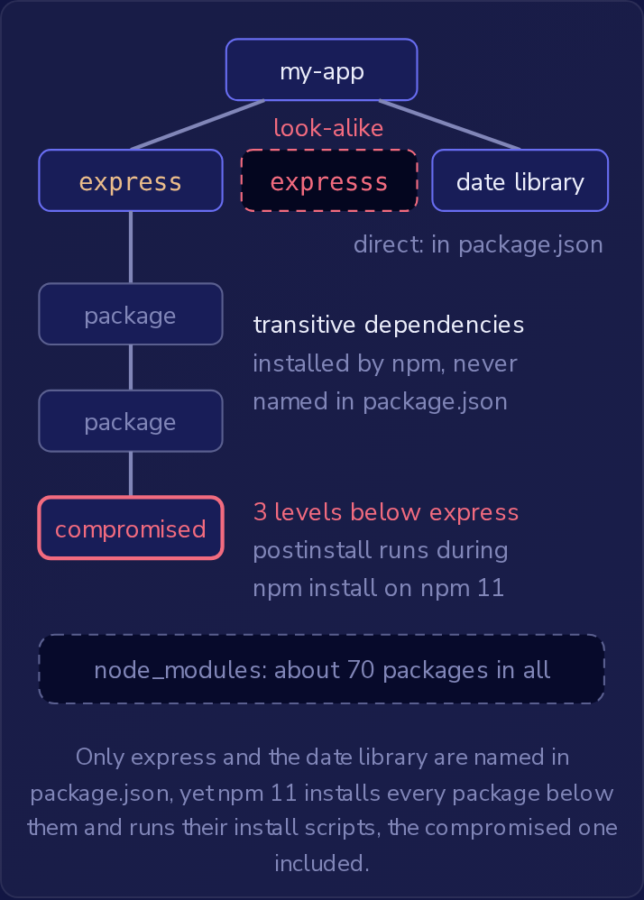

一个 Node.js 项目的 `package.json` 只列出了两个依赖，`express` 和一个日期库，但在 `npm install` 之后，`node_modules` 中大约有 70 个包。
它们全都是团队之外的人编写的代码，并且与应用自身的代码拥有相同的访问权限。
**供应链攻击（supply chain attack）**针对的正是这些代码：攻击者不是去寻找应用本身的漏洞，而是把恶意代码植入其某个依赖，再让一次普通的安装把它送进来。
OWASP 将这类攻击归类在 A03:2025 软件供应链故障（Software Supply Chain Failures）之下。

### 直接依赖和传递依赖

`package.json` 只列出**直接依赖（direct dependencies）**，也就是项目自己要求安装的包。
其中每个包都有自己的 `package.json`，列出它所需要的包，npm 也会安装这些包，然后再安装这些包所需要的包，依此类推，沿着依赖树一直向下，全部放进 `node_modules`。
因为另一个包依赖它而被引入的包，称为**传递依赖（transitive dependency）**。
无论是在代码审查还是其他场合阅读项目的 `package.json`，你看到的都只有那两个直接依赖，看不到它们下面的任何包。

传递依赖和其他任何包一样会运行。
当上一层的包加载它时，它的代码就会在应用内运行，而应用自身的代码根本不需要提到它。
这使得每个传递依赖都成为攻击面的一部分：入口点让外部数据进入应用，而依赖则让外部代码进入应用。



package.json 中只列出了 express 和日期库，然而 npm 11 会安装它们之下的每一个包并运行它们的安装脚本，被攻陷的那个包也不例外。

对于 C# 服务，NuGet 的工作方式与此相同。
`dotnet restore` 会引入 `.csproj` 文件在 `PackageReference` 中列出的每个包，以及这些包所依赖的每个包，而构建和 `dotnet publish` 的输出都会带上所有这些包。
被另一个包引入的库会加载到服务自己的进程中，每当上一层的包调用它时，它的代码就会运行。

### 安装脚本

包的 `package.json` 还可以声明**安装脚本（install scripts）**，即 npm 在安装该包时运行的命令。
它们位于 `"scripts"` 之下，名称为 `"preinstall"`、`"install"` 和 `"postinstall"`，其中 `"postinstall"` 在包的文件就位之后立即运行：

```json
{
  "name": "expresss",
  "version": "1.0.0",
  "scripts": {
    "postinstall": "node setup.js"
  }
}
```

npm 11 是当前 Node.js LTS 所附带的版本，它默认会在同一次 `npm install` 中为其安装的每个包运行这些脚本，直接依赖和传递依赖皆然。
脚本以运行 npm 的用户身份执行，没有沙箱，因此可以读取该用户能读取的任何内容。
这包括 `~/.npmrc`，其中可能保存着开发者的 npm 令牌，而在构建服务器上还包括环境变量，其中往往保存着部署令牌。
恶意的安装脚本在任何代码导入该包之前就已经完成了它的工作。
`npm uninstall` 会删除包的文件，但脚本已经发送出去的内容仍然已经发送出去了。

添加 `--ignore-scripts` 会关闭安装脚本：

```bash
npm install --ignore-scripts
```

随后 npm 会跳过它所安装的每个包的 `"preinstall"`、`"install"` 和 `"postinstall"` 脚本，传递依赖也包括在内。
安装仍然会完成，每个包都在 `node_modules` 中。
该标志只涉及安装时：包内的恶意函数无论有没有这个标志，只要应用调用它就会运行。
大多数包没有安装脚本；少数需要安装脚本的包，通常是为了给当前机器构建或下载原生代码，在脚本运行之前无法工作。
npm 12 自 2026 年 7 月 8 日起正式发布，它更改了默认行为：除非项目根 `package.json` 中的 `allowScripts` 策略允许，否则它会阻止依赖的安装脚本，而 `npm approve-scripts` 会把这些批准记录在那里。

### 仿冒包名、依赖混淆和被劫持的账户

**仿冒包名（typosquatting）**是以与热门名称相似的名字发布软件包，例如用 `expresss` 冒充 `express`，这样一次拼写错误就会安装攻击者的包并运行其安装脚本。
在运行 `npm install` 之前，对照包自己的文档（例如 Express 网站上的安装命令）检查确切的名称，就可以阻止这种情况。
单独使用 `--ignore-scripts` 会让这个相似名称的包仍然安装在 `node_modules` 中。

**依赖混淆（dependency confusion）**针对的是公司的内部包。
一家公司在自己的注册表 `https://npm.acme.internal/` 上保存着 `billing-utils` 1.4.0，该注册表同时也会透传公共 npm 注册表中的包，并且当某个名称在两处都存在时，会提供较高的版本。
公共注册表允许任何人以尚无人占用的名称发布包，并且对公司私下使用的名称一无所知，因此攻击者在公共注册表上发布 `billing-utils` 99.0.0，就能让该版本进入公司的构建。
把内部包发布为 100.0.0 没有用，因为攻击者可以发布 999.0.0。
对名称保密同样没有用：内部名称会通过公共仓库、前端打包文件和错误信息泄露出去。

修复方法是使用**作用域（scope）**，即包名前面的前缀，例如 `@acme/`。
公司在公共注册表上注册 `@acme` 作用域，并将包重命名为 `@acme/billing-utils`。
只有作用域的所有者才能在其下发布名称，因此那里不会出现陌生人的 `@acme/billing-utils`。
项目的 `.npmrc` 文件中的一行配置告诉 npm `@acme` 包存放在哪里：

```ini
@acme:registry=https://npm.acme.internal/
```

npm 会从该注册表获取 `@acme` 作用域中的每个包，无论是安装还是发布，并且不会从其他任何地方获取：一个作用域只指向唯一一个注册表，没有回退，也不比较版本。
作用域之外的包，例如 `express`，来自默认注册表，也就是 `https://registry.npmjs.org/` 上的公共 npm 注册表，除非 `registry=` 设置指定了另一个注册表。

**被劫持的维护者账户（hijacked maintainer account）**不需要假名称。
攻击者一旦拿到维护者的密码或 npm 令牌，也就是恶意安装脚本可以从 `~/.npmrc` 中窃取的那种令牌，就会以真实、拼写正确的名称发布新版本，因此检查名称什么也发现不了。
热门的包同样会被接管，而它们的影响范围正是攻击者想要它们的原因：一个恶意版本就会进入每个安装它的项目。
如果新版本在 `"postinstall"` 中窃取令牌，使用 `--ignore-scripts` 安装的构建服务器可以保住它的令牌。
但包的函数中的恶意代码仍然会随应用一起发布，并在应用每次调用它们时在生产环境中运行。
