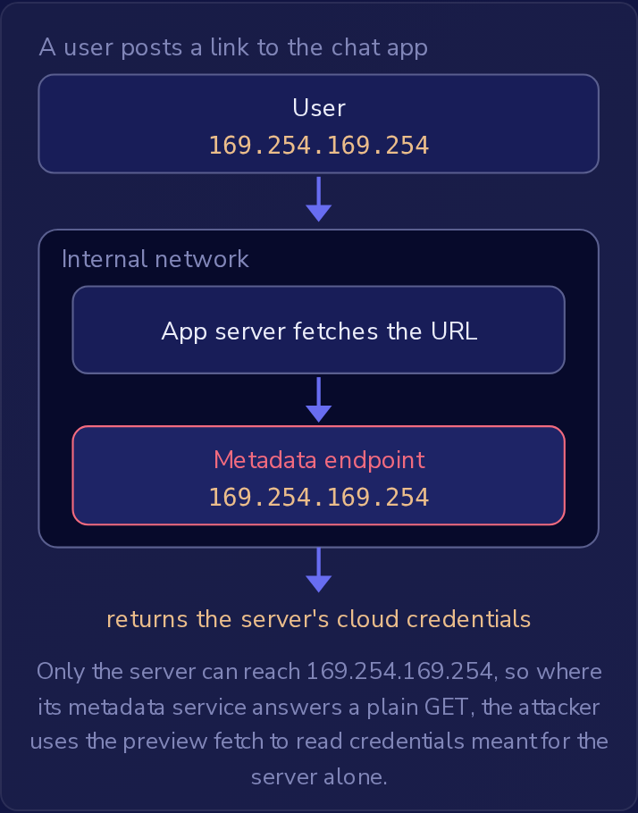

一个聊天应用新增了三项功能，每项功能都接受用户提供的 URL。
**链接预览（Link previews）**会抓取某人在消息中发布的每个 URL，并读取页面标题和图片以生成一张小卡片。
**Webhook** 允许客户保存一个 URL，每当其账户中发生某个事件时，应用就会向该 URL 发送 HTTP 请求。
**头像导入（Avatar import）**会下载用户在个人资料中输入的 URL 所指向的图片，并且只接受三个照片网站：`photos.example`、`img.example` 和 `pics.example`。
在每一项功能中，都是服务器打开连接，因此目的地是不受信任的输入：决定服务器请求发往何处的是用户，而不是应用。

这种形态就是**服务端请求伪造（server-side request forgery，SSRF）**。
服务器抓取由用户选择的 URL，因此攻击者借用服务器在网络中的位置去访问互联网无法到达的服务。
OWASP 将 SSRF 归入 A01:2025 Broken Access Control。
读者点击的链接，或应用渲染的 `src` 所指向的 `` 标签，都不属于 SSRF：该请求是从读者自己的浏览器发出的，而不是从服务器发出的。
只有当抓取的是服务器时，服务器才会伪造请求。

### 为什么服务器的位置值得窃取

服务器运行在**内部网络（internal network）**中，紧邻着数据库、管理页面以及其他对互联网关闭的服务。
其中有一个地址格外突出。
云服务器从位于 **169.254.169.254** 的**元数据端点（metadata endpoint）**读取关于自身的详细信息，在许多配置中，这些信息包括临时凭据，使服务器能够以服务器的权限调用云提供商自己的服务。
该地址是链路本地（link-local）地址：只有服务器自身可以访问它，因此攻击者无法从互联网查询它。
他们需要服务器替他们发送请求，而链接预览在有人发布 `http://169.254.169.254/latest/meta-data/` 的那一刻就会这样做。
该路径是 AWS 的路径，在仍然允许原始 AWS 元数据服务的服务器上，只需这一次普通的 GET 就能读取这些详细信息。
较新的版本 IMDSv2，以及 Azure 和 Google Cloud 上的元数据服务，只会响应携带令牌或标头的请求，而对已发布 URL 的普通抓取不会发送这些内容。

只有服务器可以访问 169.254.169.254，因此在其元数据服务响应普通 GET 的地方，攻击者可以利用预览抓取来读取仅供服务器使用的凭据。

### 看似正确却仍然失败的检查

一个拒绝任何包含单词 `localhost` 的 URL 的抓取器，仍然会加载 `http://127.0.0.1:8080/admin`。
`127.0.0.1` 是环回（loopback）地址，与 `localhost` 指代的是同一台机器，而该 URL 用数字书写它，因此单词检查没有可拦截的内容。
只接受来自本机连接的管理页面会作出响应，因为抓取器就运行在那台机器上，请求从那里到达。
更长的单词列表也会以同样的方式失败。
添加 `internal` 或 `admin` 仍然会放行 `10.0.0.5`（内部网络上的另一台机器）以及大多数内部主机名，因为它们都不包含这些单词。

**重定向（redirect）**会绕过只对发布的 URL 运行一次的检查。
攻击者将自己控制的某个公共主机，比如 `http://links.example/start`，指向抓取器；它通过了地址检查，然后以 `302 Found` 和 `Location: http://169.254.169.254/latest/meta-data/` 作出响应。
自动跟随重定向的 HTTP 客户端随后会请求该地址，而之前的检查不会再次运行。
重定向可以指向任何主机，而响应会返回给跟随它的抓取器，而不是发出重定向的服务器。
防御方法是关闭重定向，或者在跟随之前对每个重定向目标运行相同的目的地检查。

### 选择目的地检查

当功能只需要一组已知的目的地时，**允许列表（allowlist）**是最强的检查。
头像导入只接受主机恰好是其三个照片网站之一、且使用其预期协议的 URL，并关闭重定向，以防被允许的网站将客户端转发到别处。
（将其图片 URL 重定向到单独 CDN 主机的照片网站，在关闭重定向后会失效。解决办法是将该 CDN 主机添加到列表中，并且仅当目标的主机在列表中时才跟随重定向。）
较弱的规则会失败：内部名称的阻止列表会漏掉它没有列出的每个名称，在 URL 的任意位置匹配网站名称会让攻击者将真正的主机藏在路径或查询字符串中，而检查响应的内容类型为时已晚，因为请求已经到达了目标。
要求用户已登录限制的是谁来发起请求，而不是服务器将请求发往何处。

链接预览无法使用允许列表，因为它们必须适用于任何公共网站。
在这里，抓取器会查找每个主机名解析到的地址，并拒绝私有地址（例如 `10.0.0.5`）、环回地址（例如 `127.0.0.1`）和链路本地地址（例如 `169.254.169.254`），然后关闭重定向或对每一跳重新检查。
只向用户显示页面标题会缩小攻击者能够读回的内容，但请求仍然会到达内部服务。
标题是抓取器从目标响应中取得的文本，因此其中携带的任何内容都会泄露，而在到达时就会更改某些内容的请求，例如下一节中的删除操作，在读取任何响应之前就已经造成了伤害。
显示得更少永远无法取代目的地检查。
内部服务对 `https` 的响应与对 `http` 一样积极，因此协议检查无法让抓取器远离它们。

### 当请求本身造成伤害时

位于 `http://10.0.3.7` 的内部用户服务通过 `POST /users/42/delete` 删除用户，并且不要求登录，它信任只有内部网络中的机器才能访问它。
Webhook 发送器就是这些机器之一。
将其 Webhook URL 设置为该地址的客户，会让应用服务器从网络内部发送该 POST，而用户服务信任它的网络，便执行了删除。
客户只能看到状态码，但请求到达时伤害已经造成。
除非代码先检查目的地，否则 HTTP 客户端会将请求发送到 URL 指向的任何地方，因此“互联网无法访问它”就变成了“应用服务器可以访问它”。
只有当边界后面的服务保留自己的身份验证时，信任边界才能成立。
